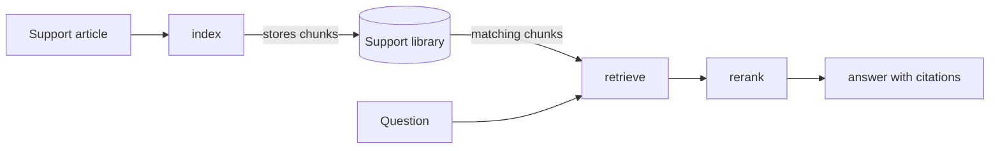
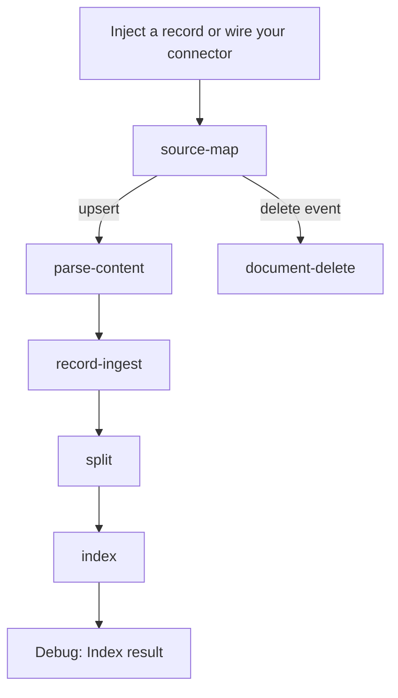
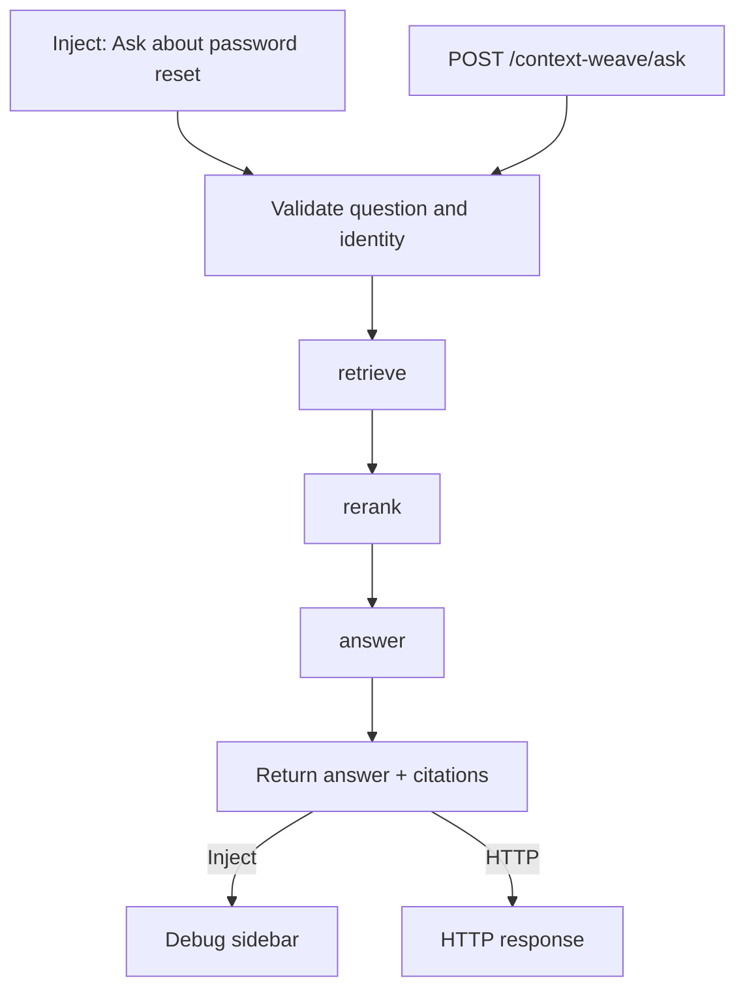

# ContextWeave for Node-RED


These badges describe the published release. The build runs on Node.js 24 and 26, and unit tests cover 91.05% of source lines.

## What is ContextWeave?

ContextWeave is a set of Node-RED nodes for answering questions using your own documents. Connect a data source, index its documents, and the flow can find relevant passages and cite them in its answers. The **context weave** palette includes 34 flow nodes and five reusable configuration nodes. SQLite stores documents, vectors, keyword indexes and conversation history under the Node-RED user directory.

New to the nodes? Open the **[complete node user guide](docs/node-user-guide.md)** for recommended flows, configuration decisions, every node option, production guidance and troubleshooting.

## Getting started

1. Use Node.js 24.14+ with SQLite FTS5 support and Node-RED 5.0.10+. From your Node-RED user directory, run `npm install node-red-contrib-context-weave` and restart Node-RED.
2. Start Ollama on the Node-RED host. Run `ollama pull nomic-embed-text` and `ollama pull llama3.2`. The example connects to `http://localhost:11434`.
3. Open **Menu → Import → Examples → node-red-contrib-context-weave → support-rag**, then deploy the flow. You can also import [the flow JSON](examples/support-rag.json) directly.
4. Click **Index sample password-reset article**. When **Index result** appears in Debug, click **Ask about password reset**. The response should cite the article and say that the link expires after 30 minutes.

## Explore the support flow

The example has two entry points. Index the article once, then ask questions against the same library.



<details>
<summary>Follow an article from your connector into the library</summary>



To use your own data, replace **Index sample password-reset article** with your connector. Open **Map connector record** and select the fields for the stable record ID, content and metadata. The example uses `tenant_id` to keep tenants separate and retrieves records with `status` set to `published`.

</details>

<details>
<summary>Follow a question from Inject or HTTP to a cited answer</summary>



Try **When does the reset link expire?** The article says **30 minutes**. Expand `payload.citations` in Debug to find the document ID behind the answer.

</details>

## Choose a vector database

SQLite is the default. For external cosine search, add a **provider** and select it in the library’s **vector provider** field.

| Provider adapter | Example base URL | Setup |
| --- | --- | --- |
| Qdrant | `http://127.0.0.1:6333` | Enter the API key if required. ContextWeave creates cosine collections. |
| pgvector | `postgresql://app@127.0.0.1:5432/support` | Enable `CREATE EXTENSION vector` in the database. Enter the database password in the provider credential field and grant the role permission to create its vector table. |
| Chroma | `http://127.0.0.1:8000` | Use a Chroma v2 server with the default tenant and database. Enter its token if required. |

Local-only libraries require a loopback endpoint. Other hosts require TLS and a compatible library privacy setting. Keep the SQLite user directory when using an external service. It holds document text, filters, keyword search and pending vector changes. On first use, an external provider receives existing vectors. Use a new library ID when switching between external services.

## Configure models and access

A **provider** stores the service URL and Node-RED credential. A **model-profile** selects the model ID, purpose and privacy policy. Select an embedding profile in the library and a generation profile in the answer node. The local example stores everything on the Node-RED host. To send data to a managed service, explicitly select compatible library and model privacy settings and enter your provider credentials.

For **POST /context-weave/ask**, wire your authenticated identity step before the validation Function and set `msg.auth.tenantId` from that trusted identity. The route returns HTTP 401 when the identity is missing. The Inject nodes use a local example tenant.

## Develop

```sh
npm ci --ignore-scripts
npm run build
npm run check
npm test
npm run coverage
npm audit --audit-level=high
```

Tests use a local model fixture and a temporary Node-RED instance. Each node has a runtime JS file, editor HTML and help text in `nodes/`. Shared implementations live in `lib/`. Run `npm run build` after editing field definitions or editor metadata; it regenerates both editors and the user guide. CI checks both supported Node.js release lines and enforces a minimum 70% line coverage across library code.

See the [node user guide](docs/node-user-guide.md), [design blueprint](docs/design.md), and [implementation scope](docs/implementation.md) for usage, architecture and release boundaries. MIT licensed.

## Release to npm

Merge a version bump in `package.json` to `main`, or manually run **Publish npm package** on `main`. A read-only job rebuilds, tests and audits the package. A separate runner publishes the verified commit with lifecycle scripts disabled and a short-lived GitHub identity. An already-published version is skipped.

One-time setup is required before the first automated release:

1. Keep your chosen repository visibility. Public repositories also qualify for automatic npm provenance.
2. Publish `0.1.0` manually with `npm publish --access public`, after running the checks above.
3. In npmjs.com, open this package’s **Settings → Trusted Publisher**, select **GitHub Actions**, and enter owner `sidisl16`, repository `node-red-contrib-context-weave` and workflow filename `publish.yml`. Leave the environment blank and allow direct `npm publish`.
4. On `main`, increase `version` with `npm version patch`, commit the updated `package.json` and lockfile, then push. The workflow publishes that new version.

After npm accepts the package, submit its npm name manually at [the Node-RED Flow Library add-node page](https://flows.nodered.org/add/node). New catalogue submissions are not automatic.
